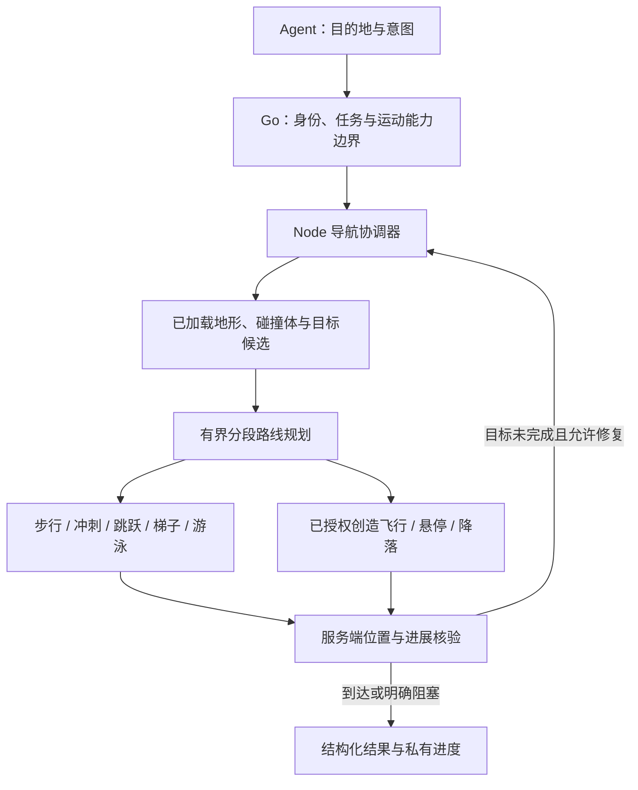

# MineAgent 导航重设计（Navigation V2）

状态：2026-10-21 设计提案，尚未实现、替换依赖或上线。本文定义下一版导航；当前运行行为仍以 body/README.md 的已发布条目为准。新增飞行、跟随、有限跳跃等能力必须逐项验收后启用。

目标：Agent 提出目的地和行动意图，身体持续完成目标解析、寻路、避障、动作执行和路线修复。让“过来、绕过去、上楼、去岸边、飞到屋顶、稍微后退”成为稳定能力，减少模型反复猜坐标。导航不挖路、不搭柱、不通过命令传送或自动切游戏模式。

## 1. 决策与开源复用

推荐保留 Mineflayer + 当前锁定的 mineflayer-pathfinder 作为地面规划基础，新增一个确定性的导航协调器和受控的飞行执行器。先修目标/地形语义，再增加运动模式；本轮不重写全部 Minecraft 物理，也不同时引入多个默认寻路引擎。

| 候选 | 已核对能力 | 对本项目的决定 |
|---|---|---|
| [Mineflayer Pathfinder](https://github.com/PrismarineJS/mineflayer-pathfinder/blob/master/readme.md) | A*、可配置运动、复合目标、动态重算、游泳；路径生成器可分片求解 | 首选复用；继续锁定已测试提交，新增能力不等于自动升级 master |
| [Baritone](https://github.com/cabaletta/baritone/blob/master/FEATURES.md) | 分段规划、区块缓存、移动代价与多种目标 | 借鉴分段与代价设计；其[客户端集成方式](https://github.com/cabaletta/baritone/blob/master/SETUP.md)意味着要评估新的机器人运行栈，不作为本轮替换 |
| [@miner-org/mineflayer-baritone](https://github.com/miner-org/mineflayer-baritone)（接口名 ashfinder） | 文档提供复合目标、游泳、梯子和部分路径重规划 | 同一场景集的候选对照；未验证当前协议桥、取消和保护，不因功能清单较长就切换 |
| [Prismarine Physics](https://github.com/PrismarineJS/prismarine-physics) | 基于玩家状态及控制输入的物理模拟 | 用于跳跃/落脚短时验证；不能替代服务端实际位置确认 |
| [Mineflayer creative API](https://github.com/PrismarineJS/mineflayer/blob/master/docs/api.md#botcreative) | 提供飞行基础方法，但 flyTo 不做避障 | 只参考底层能力，不能直接将远距离 flyTo 当作飞行规划器 |

上表是对上游文档与代码的核对，不是本项目兼容性或成功率实测。Pathfinder 为 MIT；Baritone 声明 LGPL-3.0；ashfinder 包元数据声明 ISC，完整授权和传递依赖在引入前复核。实现时优先组合公开 API；确需修补运动生成器时锁定最小补丁与测试，避免无记录地改 node_modules。

上游 master 另有 [createHuman 控制器](https://github.com/PrismarineJS/mineflayer-pathfinder/blob/master/lib/human.js)，可作平滑转向的后续候选，但当前项目锁定版本未承诺包含它。文档说明其不覆盖游泳等全部模式，因此不作为统一执行器；不把随机停顿、故意失误或所谓反检测作为鲁棒性的来源。

## 2. 需要修正的问题

此前离线复现说明：部分目标指定了水面上方十余格的空中位置，扩大搜索范围仍无路；另外，当前严格要求目标“所在列”可站立，会拒绝实际可在目标半径内停下的路线。两类问题都必须在目标解析阶段处理。

当前附近地形摘要只适合近距离选点，不能承担远途路线图。上下8格的列扫描不能代表整个已加载高度范围；无地面、区块未知、水面与封闭房间也不能统一报 noPath。创造模式目前只改变游戏身份，没有自动变成已验证的飞行执行能力。

## 3. 架构：意图、规划与执行分开

Agent 决定“去哪、为什么去、允许哪类移动”，不负责逐跳或逐帧操作。Node 不调用模型，也不自行发起新任务。Go 继续管理已验证 operator、审批、租约、取消与审计；不将权限决策下放给模型或第三方寻路库。

第一版只用一个导航协调器，地面和空中两类规划/执行分支；目录建议为 `body/src/navigation.js`、扩展既有 `terrain.js`、`body/src/locomotion.js`，`minecraft.js` 保留协议适配。协议、Go 校验与工具 schema 同步扩展，不先建立通用多引擎插件框架。

## 4. 目标契约：先定义什么叫“到了”

### 4.1 三类目标

- `surface`：只给 x,z，目标是该水平区域内可达且适合当前模式的表面。保留多层楼面候选，不直接选全世界最高点或离当前 y 最近的一层。
- `near`：给 x,y,z 和 range，目标是以该点为中心的三维到达范围，允许停在范围内其他安全列。目标列是墙不等于整个目标不可达。
- `air`：明确需要到空中坐标或悬停；必须有实际有效的飞行能力。不能把空中目标默默改成下方水面或地面。

旧 `body_goto` 的 x,z/y/range 保留：缺 y 默认为 surface，有 y 默认为 near。显式 `goal=surface` 可提供高度偏好；`goal=air` 不允许省略 y。`player` 使用当前可见玩家状态解析 near，跟随则是单独的持续目标。

### 4.2 候选集合与高度解析

1. 先验证有限数值、世界身份、世界边界与原参数上限。
2. 在请求的水平/三维到达范围内枚举候选脚部位置；每一列可保留多层，使用真实形状处理台阶、半砖、耕地和地毯。分批扫描目标相关的已加载 section，高差大时仍受扫描配额限制。
3. 候选必须满足身体碰撞体、净空、支撑/水面/空中模式要求；地面目标排除危险支撑。未知 section 不当作空气，也不当作确定障碍。
4. 只对满足原始到达谓词的候选做多目标搜索。采用公开 GoalCompositeAny 或带候选索引的等价目标，最后用同一世界坐标谓词验证，避免整数搜索节点与实际脚部位置不一致。
5. 显式坐标无法满足时，返回具体原因与备选，不擅自降低高度、扩大 range、换楼层或进入水中。备选不算已经到达。

建议保留最多32个精细目标候选，先按空间/高度/连通分组再挑选，防止32个都集中在被墙隔开的同一角落。启发式采用到候选集合的保守距离下界；复合目标不能借最近点启发式剪掉其他可达候选。

到达需连续3个服务端位置样本满足原目标，且地面/落地目标已站稳，跟随满足距离与视线约束。最终核验复用/扩展本项目Paper只读玩家查询，在到达短窗口内按100–200ms间隔取样；不以Mineflayer本地move事件或低频旧缓存充当服务端确认，不额外调用模型。样本须新鲜、同世界且对应当前导航；查询不可用则返回未确认，不能报reached。当地客户端坐标、目标代次、层级与服务端状态不一致时也不得报 reached。

## 5. 地形模型与分段寻路

### 5.1 地图范围

只使用机器人已加载的区块及轻量缓存，按区块/section版本失效。保留站立面、通道、梯子、水面、门、危险与未知边界；不复制全服世界或为了寻路强制加载远方区块。内部地图比给模型的摘要详细，模型只取少量可达建议。

长距离使用两层规划：已知区块之间的通道/区域图决定方向，局部 A* 求实际可执行路径。粗图的相邻区块不自动视为连通，必须存在已验证通道；只有粗略路线时标注 provisional。跨楼层保留不同区域，不能用一张最高高度图覆盖室内。

远方未加载时，选择已知安全区域里的探索边界，执行一小段并等待新地形，再规划。临近边界的若干格保留停步余量。没有安全探索边界返回 terrain_unknown；请求部分路径不等于授权走进未知区块。

### 5.2 地面规划

复用 Pathfinder 的分片 A* 和运动生成。代价由预计时间、地形风险、净空余量、切换次数及临时失败边构成，所有代价非负。启发式采用速度上界得到的时间下界；初版不用未经验证的加权启发式或自适应“学习捷径”。

运动边涵盖平走、上/下台阶、单格跳、受限缺口跳、梯子与水面；挖掘和放置边始终禁用。狭窄边缘用潜行，平坦畅通处允许冲刺。转弯平滑仅在身体扫掠碰撞验证通过时使用，不跨过原始路线的障碍。

先实现受限区域/区块图和局部 A*，不同时引入 D* Lite、JPS、RRT*。图更新后使受影响路径失效并局部重算即可；是否需要增量搜索由基准数据决定。

### 5.3 空中规划

创造飞行采用单独的有界3D A*，节点是可容纳完整身体的自由空间，不能复用只关心脚底支撑的地面图。初版1格网格，必要时在狭窄局部细化到半格；26邻接的每条边均做完整扫掠体碰撞验证，禁止对角穿墙/切角。

空中节点区分可悬停、可降落及未知。起飞点有头顶净空，降落点有支撑与稳定余量；进入飞行前先计算一段可执行航路及安全停驻点。长途仍分段，路径平滑必须经过同样碰撞检查。跨水时可保持空中飞行；落点不因为水面可悬停而被误报为已落地。

空中与地面在少量已验证的起飞/落地点连接，用切换成本避免走两步飞两步。用户只要求到达时，auto 比较地面路径和飞行路径；保留当前模式，除非切换收益明显或当前模式无法完成。明确要求飞行/步行时尊重该约束，不偷偷换模式。

## 6. 更灵活的运动能力

| 能力 | 默认设计 | 触发条件与限制 |
|---|---|---|
| 行走、冲刺、潜行、单格跳 | 首批 | 地形与净空通过；不持续按键盲冲 |
| 楼梯、半砖、耕地、梯子 | 首批 | 真实形状/支撑与脚部高度；攀爬方向明确 |
| 木门与栅栏门 | 首批 | 路径上的明确交互边；空手；只操作已验证可安全通行的木门/门扇状态，不扩展到按钮、铁门、活板门或容器 |
| 水面游泳与上岸 | 第二批 | 已找到入口、可呼吸水面及出口；计算氧气/体力余量；不默认潜水穿洞 |
| 创造飞行、悬停、降落 | 第二批必做 | 实时创造模式 + 服务端飞行许可 + 当前任务允许；先完成可取消飞行原型与协议桥验收 |
| 有限缺口跳跃 | 后续 | 只放开物理模拟和隔离测试证实的动作，初始最多1格缺口、稳定落点；不直接打开所有 parkour |
| 精确侧移、后退、面向目标移动 | 首批接口，随后验证 | 距离/时间有界、方向扫掠已知安全；不开放任意长时原始按键 |
| 跟随与保持距离 | 后续 | 可见同世界目标、停止/远离/失联立即收束；不穿未经验证的门或进入未知区域 |

这里“首批/第二批”指实现顺序，均尚未改变当前服务。auto 仅能使用已经通过验收、配置允许且服务器实际授予的能力；测试未通过的模式没有自动降级为实验实现的入口。

### 6.1 飞行不能只调用 flyTo

[Mineflayer 文档](https://github.com/PrismarineJS/mineflayer/blob/master/docs/api.md#botcreativeflytodestination)说明 flyTo 是无寻路的直线移动；核查当前安装的4.39.0与[上游源码](https://github.com/PrismarineJS/mineflayer/blob/master/lib/plugins/creative.js)，它修改本地重力/位置且没有 AbortSignal 式取消接口。因此不使用一个无法取消的远距离 flyTo Promise，也不将本地 gravity=0当作服务端已授权飞行。

必须先验证：从服务端协议读取实际 allowFlying/flying/speed，按正常能力协议请求飞行，确认有效模式，再以可取消的逐tick控制驱动路线。当前物理/协议支持不足时，在同一Node身体里做最小适配并测试，不能把本地改坐标当成已通过的物理实现。不自动发 /fly 或 /gamemode，不用旁观穿墙、OP、瞬移或反作弊绕过兜底。

停飞需要按语义处理：普通取消在权限仍有效时制动并悬停，等待下一条明确指令；正常到达地面目标后确认落地才关闭飞行。空中管理员暂停同样制动保持可控悬停，不偷偷飞去“安全点”；撤权/失联由控制器停止推进、拒绝后续模型动作并按服务器既有能力处理，不发一段未授权的降落路线。能力被服务器撤销后不能保证悬停或无伤落地，须保留恢复重力/自然下落这一真实限制，并作为故障注入用例。

## 7. 执行与路线修复

导航状态：`resolving → planning → moving → verifying → reached`。可穿插 `waiting_chunks / waiting_obstacle / replanning / waiting_resume`，所有状态都能进入 cancelled/blocked。一个导航动作独占输入所有权；Go/Paper/模型没有第二条并发操控通道。

每tick核验租约、epoch、授权、目标代次、运动能力和下一段扫掠体；即将碰撞先制动。动态实体阻路先短等，再绕行；不会为了过人而攻击或推挤。仅执行已验证的路径前缀，后续计算完成前在已知安全点停住。

卡住依据路线弧长进度、当前段完成度、速度与服务端纠正判定，不能只比较到最终目标的直线距离。U形绕路开始时可能离目标更远，属于合理进展；对重复走回同一条边的振荡则累加失败代价。

有界恢复顺序：

1. 释放当前推进输入，确认动作实际位置；不一遇到 noPath就全局暂停。
2. 区块未知则等待有界加载；实体占路先短等；门状态变化重验门边；服务器纠正则先减速/重算当前局部。
3. 切换到同一到达范围中的其他候选，或规划另一条已知通路；失败边仅在当前局部版本下暂时加价。
4. auto 可在任务已有权限和实际能力内切换运动模式；ground-only不擅自改飞行。
5. 耗尽修复预算返回 blocked 和一个可操作原因，保留任务目标；连接/授权失效仍按既有规则取消，不无限重试或重复副作用。

建议每段最多3次局部修复，同一边/同一地形版本不重复撞3次；约1.5秒无路线进展触发检查，阻塞实体先等至多1秒。都是待测初值，不替代既有单动作总时限。真正外部传送/连续服务器纠正仍使用现有暂停规则；不借导航修复自动解除管理员暂停。

## 8. Agent 工具与协议

主要入口继续是 `body_goto`，扩展可选 `goal=surface|near|air`、`movement=auto|ground|fly`。这是允许能力的上界，不是强迫开启某模式；旧调用保持兼容。增加一个只读 `body_plan_path` 提供候选/模式/预计代价/阻塞摘要，不移动、不装备、不点门、不预加载世界，不消耗动作授权。它计入已有连续只读预算。

精确移动使用 `body_move`：相对方向、距离、速度和可选注视目标，初始单次最多3格/1.5秒，复用动作取消、输入所有权与扫掠检查。`body_follow` 是有期限的跟随动作，初始每次最多20秒，不创建脱离Agent任务的常驻自主行为；后续任务是否继续跟随由现有任务生命周期决定。

不增加单独 fly/swim/jump 工具让模型逐步拼路线。到屋顶、过河、上下楼由一个goto在允许能力里完成；明确后退或保持距离才用对应动作。新工具仅进入已验证操作者的私密工具集合，普通MC继续只获公开body_profile。

只读计划带 `planId`、connectionId、epoch、policyRevision、worldId、targetRevision、mapRevision和短有效期。计划是有界私有缓存，不把所有节点暴露给模型；它不是approvalGrant，执行前重验全部权限与最新地形。可复用仍有效的规划，不能把预览成功当成未来一定能走通。门交互状态需绑定具体门与当前状态，过期就重新检查。

旧 `range` 1–8及单动作最多20秒先保留；远途返回有进展的partial/checkpoint，保留原目标和导航会话，后续调用继续，不能称为最终到达。一次goto内部的局部重算/模式切换不额外调用模型，但每次仍受CPU/动作总预算约束。连续只读上限与现有任务步数设置继续有效，本设计不擅改这些偏好。

## 9. 结果与可观测性

结果必须分开提供：原请求目标、解析后的候选/实际落点、使用模式、到达谓词是否满足、实际位置、路线进展、修复次数、终止原因和阶段耗时。`partial=true`不是成功到达；本地规划器success也不是实际到达。

错误至少区分：`terrain_unknown`、`target_in_air`、`no_safe_surface`、`water_only`、`flight_not_allowed`、`flight_unsupported`、`no_route`、`search_budget_exhausted`、`dynamic_obstacle`、`stuck`、`server_correction`及既有授权/暂停类错误。最近可达点只作有标识的备选，不能偷偷换成新目标。

私有进度展示“解析目标、规划地面路线、等待区块、飞行中、重新选路、已到达/受阻”；记录模式切换与各阶段耗时、失败边类别及服务端纠正次数。公开投影仍仅显示在线/活动/暂停，不泄露私有路线、坐标或地图。

## 10. 安全与资源边界

出生点X/Z各±512的全高度保护仍只拦方块破坏/放置及WorldEdit，不限制经过、飞越或观察。导航不得把保护区当成禁行区，也不得为了走通路线隐式编辑世界。Go审批、Paper写入守卫、非OP与实时operator gate全部保留。

内部允许的自动门交互仅是明确验证的可开木门/栅栏门集合，每次核验两只手、方块状态和权限；其他交互仍走原body_interact及审批。禁止第三方库绕过守卫自动点击容器、按钮、活板门、床/重生锚等。生存模式只用实际可用的地面/水面能力，创造飞行不通过自动命令获取。

初始资源建议：每tick规划片≤8ms、每段累计规划≤500ms、最多2万展开节点，超出先返回可用前缀或明确预算错误；一次只求解一个规划器，下一段预取与执行错峰。缓存增量目标≤64MiB、最多64个近期区块摘要及256条临时失败边，独立LRU，不强行改变Mineflayer原区块缓存。地图读取、碰撞检查与候选枚举也必须分片，不能只有A*让出事件循环。

这些数值是预算起点，必须测P95事件循环延迟、心跳/租约、内存、Paper MSPT与实际成功率。达不到就缩小局部窗口/减少模式候选，不能先提高全机内存上限或关掉租约。所有重型验收延续既有cgroup硬上限和主机余量检查，不直接在生产启动第二套测试服。

## 11. 实施顺序与验收

| 阶段 | 工作与交付 | 通过条件 |
|---|---|---|
| N0：目标正确 | 到达区域候选、分层高度、未知/水面分类、计划接口、统一到达谓词 | 墙边可达不拒绝；空中/水下假目标不误报；不产生任何规划副作用 |
| N1：地面鲁棒性 | 分段路线、进度判定、障碍恢复、门/梯子/精确移动 | U形绕行不因直线距离变远而误停；门关闭/实体拦路可修复；跨未知区块前停稳 |
| N2：灵活移动 | 可取消创造飞行、悬停/降落、水面游泳/上岸，必要协议适配 | 授权创造身体可跨高差/水面到屋顶；能力撤销/急停不继续执行路径；生存无越权飞行 |
| N3：运动质量 | 有限缺口跳、短时跟随、转向/速度平滑 | 同地形重复任务稳定，控制取消及时，无抖动或反复模式切换 |

每次记录固定依赖版本、夹具种子、请求目标、规划时间、真实到达时间、路径长度、最小净空、重算/纠正次数、结果及资源峰值。不能把“附近移动几次成功”当作复杂地形/飞行验收。

必测场景：

- 目标列为墙但range内有通路；半径内候选分属不同房间；楼板上下同XZ；台阶/半砖/耕地；低顶与斜角。
- 水面比请求y低十余格；悬空坐标；无地面/虚空；大落差；地形未加载与超预算。使用合成夹具，不提交真实世界数据。
- U形和长绕路；窄道实体阻塞；门中途关闭；区块加载迟到；小幅纠正与外部大传送；重复边振荡。
- 创造模式跨水/楼顶的地面→飞行→落地；起飞头顶障碍；空中急停/暂停；空中撤销飞行许可或失联；禁飞区域/服务器拒绝；重连不重放。
- 水面游泳入口/出口、氧气不足、无安全上岸点；明确潜水/危险跳跃不在默认能力内。
- 规划中取消、执行中取消、撤权、目标过期和审批代次变化；原生面板与网页均能停止，普通MC无法拿完整移动工具。

建议可执行场景每类至少20次，成功率目标≥95%，安全越界/未授权世界写入为0；已知不可达夹具应稳定返回正确错误，不能计入应到达分母。3–5格任务保持既有P50<15秒目标，直接已知短坐标goto P50<5秒；另记录P95和完整成功率，不用成功样本中位数掩盖失败。停止输入延迟目标P95<250ms、确认清理≤1秒，门交互/飞行也包括在内；性能目标需在实现后验收，不是当前已取得的数据。

只有对应阶段全部通过才按既有维护流程上线；本设计不包含部署或恢复暂停授权。第一轮先交付N0/N1，再把N2作为下一优先级，飞行原型若不能证明可取消与服务端认可，则报告阻塞，不以直线改坐标的临时实现充数。

## 12. 首轮实现记录（2026-10-22）

针对出城任务先实现N0的一部分及受限水面导航：整个到达区域的地面/水面候选、上下32格已加载扫描、显式高度不静默改写，ground与swim显式模式，以及水面下落/潜水守卫。尚未实现只读规划工具、全局区域图、飞行、跟随与N1全部路线修复；后续按真实任务的阻塞继续迭代，不把本轮子集当成V2全量交付。

验证：全仓Go测试、vet、身体/Agent/网页相关race与22项Node单测通过；隔离真实Paper/ViaProxy的完整身体回归通过（87次模型夹具调用），包括双层水面往返、地面模式拒水、暂停/停止和WorldEdit边界/跨区保护。门户浏览器回归通过；首轮出现一次既有跨页动画InvalidStateError，保留错误断言后复测通过，未屏蔽页面错误。

限制：水面能力验收针对平岸入/出水；高挡岸、复杂转角仍可能触发服务端位置修正，保持原有暂停规则，不能据此关闭安全保护。全局路径修复与更全面岸线场景仍待后续实测。

### 12.1 停手下沉后的受控上浮

真实分段任务暴露：到达水面后停止输入，身体会在两次工具调用间自然下沉；仅修正整数高度不足以处理下一次起步。新增swim动作内部的有界上浮阶段：只检查已加载、连续开放且覆盖身体宽度的水柱，上探最多16格，上浮最多8秒；仍受动作总超时、租约和取消控制，不增加任务外按键。终点仍限开放水面/陆地，不开放水下水平路径。隔离验收新增四格深水池，等待实际下沉后再次上浮上岸，及遮顶/未知/过深拒绝、取消无残留定时器。

### 12.2 游泳路线代价与岸角起步

实测发现默认液体惩罚让显式swim沿干岸绕行，诱发反复上下岸；swim单独设liquidCost=0，地面模式不变。合成岸线断言复现旧惩罚的绕岸，新代价保持直接开放水面路线。上浮起步提升到水方块Y+0.5，避免从岸沿以下横移；仍只使用物理跳跃输入、保留3格下落与连续修正暂停。Agent规则明确无进展不得原样重试同一目标，应换侧向安全航点；总轮数以真实taskLimits为准。全仓Go/vet/相关race、Node回归和完整真实身体E2E通过，保护阈值未改变。

### 12.3 浸水半格登台与修正窗口

真实浸水半砖坡道出现连续约0.003格碰撞修正，按包计3次上限过早中止正常爬阶。改为2秒累计修正≤0.75格、最多40包；单次>0.75、未知起点或无活动动作仍暂停，快照立即失效，显式恢复开启新窗口。重复0.3格会更早触发累计上限，20次数毫米修正可完成原动作；无自动解除暂停。新增真实浸水半格坡道登台往返验收，完整身体回归90次夹具调用通过；诊断返回实际运动状态，未增加坐标写入/飞行或新的世界权限。

### 12.4 浸水半砖上的重新起步

半砖含水会让onGround=false，脚部却已在实体支撑上；新增脚下形状检查，只有实体形状全在脚面下的含水支撑才可量化到正确寻路节点，顶板/未知水柱仍拒绝。针对客户端0.3/0.7边界夹紧和服务端毫米级边距差异，只识别已知完整碰撞面、无按键、单轴≤0.025格且高度仅有水中至多1厘米重力抖动的精度包，立即失效方块编辑/物品/审批准备项，移动须执行前复核，但不反复锁存新的暂停；0.5格空闲移动、无已知接触、未知起点与已锁存暂停保持原规则。新增浸水半砖定位后明确恢复、空闲再登台的真实场景。高台到水面采用已知坡道航点返回，直接侧跳深水再切岸仍是后续执行层场景，不放宽暂停或下落保护。

### 12.5 代理组合的保守碰撞预测

原生精确停步复现了当前位置被整步拒绝，根因是客户端/服务端接触边界预测差异。当前锁定26.1→26.2代理组合的swim动作采用0.32半宽预测，动作结束/失败/取消恢复原值；贴面时先在当前格内受控退让约0.22格、最多1秒。只用真实按键和物理反馈，不设置实体坐标/速度。保留精度包下的低风险goto/look_at/command准备项并执行前重新描述；方块写入/物品/审批准备项仍失效。注入150ms准备响应延迟，原生精确位置(14.5,-59.465,9.697)重新登台到Y=-58用时1737ms；完整真实回归91次模型夹具调用通过。跨版本裕量不是对其他版本的兼容承诺，高岸仍采用坡道/侧向航点。

水边精度修正不再作废普通命令准备；命令执行仍重新描述世界、位置、双手并校验 epoch/有效期，随后走原生权限和 WorldEdit 写入保护。方块、物品及需审批的动作仍作废，不恢复已暂停身体。新增真实含水台阶命令回归，避免修复自己入口时连续 stale。

现场另发现相同已知碰撞面的1.025厘米单轴舍入纠正；精度分支界限调整为2.5厘米，仍必须无按键、干地Y不变（水中允许至多1厘米重力抖动）、客户端精确夹紧0.3/0.7、已知完整碰撞面。3厘米/普通空闲位移/未知接触仍暂停，不改变活动动作0.75格累计和40包上限，也不解除已有暂停。

无移动输入的body_command回显等待期间也使用上述严格接触精度判定，避免纯命令被水流数值修正耗尽运动纠正预算；普通移动和不满足精度条件的包仍按原上限暂停。首次新增播种集成在既有含水命令场景出现forced_move/unknown，保留原断言复测通过该场景，并据此补足静止命令回归，未取消暂停/停止或未知副作用保护。

接触面核查覆盖当前实体实际高度（至多1.8格），识别游泳时脚仍在水里、躯干碰岸的完整水平碰撞面；不再只查脚所在Y层。未知层、仅在头顶以上的方块、超过实际身体高度的面及有移动按键时不使用精度分支。新增真实躯干接触停步后恢复/静止/原生命令回归。

已知水平接触夹紧仍限制单水平轴2.5厘米，另允许随附至多1厘米的水中重力数值抖动；纯竖直位移、双水平轴、较大竖直变化、未知接触或有移动输入仍不使用精度分支。ground从湿梯起步也先做有界退让，退让期间持续请求同一真实朝向，避免服务端修正覆盖yaw；不写坐标/速度。新增湿底梯到干落点的真实回归。

地面目的地若从水中起步，动作内同样先检查并上浮，再按ground的干地路线行走。含水梯子只在实体形状完全不与玩家水平包围盒相交时作为开放水柱，干梯子中央同理；未知块、重叠面或顶板仍拒绝。上浮仍16格/8秒、限当前动作，不后台托浮、不穿墙。

锁定版pathfinder适配：仅湿梯上攀边保留原生障碍/实体检查并允许连续梯子上行，不将普通水节点改为可攀登；梯子路径点按原始搜索格中心/高度归一，避免把立面顶端当作不可到达的落脚点。到达判定需匹配解析出的安全落点，梯子立面若不支撑玩家包围盒则不列为站立面，不再仅凭到达球内的悬空点报成功。所有修改只作用搜索与真实按键，不改实体位置或方块。
